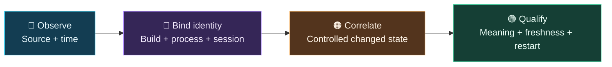
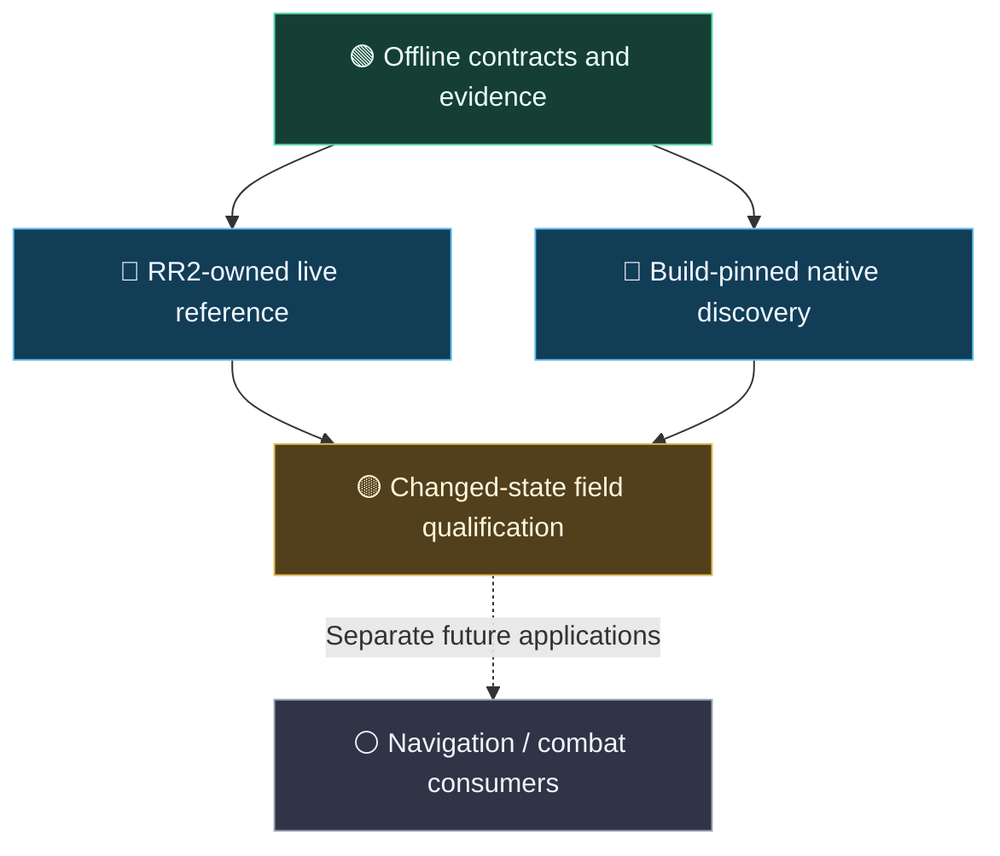

<div align="center">


<br />

[](global.json)
[](src/)
[](addon/)
[](scripts/)
[](src/RiftReader2.Live/)
[](https://github.com/360madden)


[](docs/reference/self-contained-api-reference.md)


**A modular toolkit for observing, validating, and understanding the RIFT game client.**

*In-game Lua references. Native Windows observations. Independent verification. Durable research.*

[🚀 Quick Start](#-quick-start) · [🧠 Architecture](#-architecture-at-a-glance) · [📊 Capability Map](#-capability-map) · [🧪 Research Tools](#-explore-the-toolkit) · [🧭 Roadmap](#-where-the-research-is-going) · [📚 Documentation](#-documentation-hub)

</div>

---

## ✨ What is RiftReader2?

**RiftReader2 (RR2)** is an independently developed, hybrid telemetry and reverse-engineering research toolkit for the **RIFT MMORPG**. It brings together a versioned **in-game Lua addon**, a modular **.NET 10** codebase, read-only native observation tools, and reproducible evidence workflows.

### 📡 Project signal board

<table>
<tr>
<td width="25%" align="center"><strong>🟢 OFFLINE CORE</strong><br/><sub>Contracts, capture validation and reproducible analysis</sub></td>
<td width="25%" align="center"><strong>🔵 LIVE REFERENCE</strong><br/><sub>Identified-session workflows; RR2R1 acceptance pending</sub></td>
<td width="25%" align="center"><strong>🟡 NATIVE FIELDS</strong><br/><sub>Build-bound candidates; semantics still under qualification</sub></td>
<td width="25%" align="center"><strong>🟣 RR2-OWNED</strong><br/><sub>Legacy RiftReader is a reference, not a runtime dependency</sub></td>
</tr>
</table>

*Colors describe the linked scope, not the current health of a running RIFT client. [Live status and blockers →](docs/status.md)*

Its central question is simple:

> **What did we actually observe, how fresh is it, and how confidently can we identify it?**

Instead of treating a matching number in memory as proof, RR2 records *where a value came from*, the *exact game build and session*, the *timing of acquisition*, and which *meaning or restart claims remain unverified*.

<table>
<tr>
<td width="33%" align="center"><strong>🔍 DISCOVER</strong><br /><sub>Inspect API observations, read-only memory candidates, pointer paths, and patterns.</sub></td>
<td width="33%" align="center"><strong>🧬 VERIFY</strong><br /><sub>Compare sources, preserve identity, and distinguish evidence from interpretation.</sub></td>
<td width="33%" align="center"><strong>📈 UNDERSTAND</strong><br /><sub>Analyze captures, explore results, and build durable game knowledge.</sub></td>
</tr>
</table>

## 🧠 Architecture at a glance


**Three deliberately separate evidence paths:**

- 🩵 **Lua API reference** — the in-game addon samples supported RIFT APIs and publishes bounded, versioned frames. Nonce binding supports a live observation lifecycle.
- 💜 **Native discovery** — a Windows-only reader investigates game-process data, with read-only acquisition and explicit executable/process identity.
- 🧡 **Saved evidence** — hashed capture manifests, offline replay, assessments, and reproducible comparison artifacts remain useful without a running game.

They feed the **Domain → Application → Infrastructure** core, composed by either **CLI** or the isolated **Live** executable. See the [architecture guide](docs/architecture.md) and [hybrid design decision](docs/decisions/0002-hybrid-addon-and-reader.md).

### 🔎 The proof ladder

A data point progresses through distinct evidence states; collecting a matching value does **not** skip the checks in between.



For the precise qualification rules, see [field catalog](docs/reference/field-catalog.md), [native capture](docs/reference/native-capture.md) and [current status](docs/status.md).

## 📊 Capability map

<sub>Legend: 🟢 implemented/verified within the linked scope · 🔵 available in controlled workflows · 🟡 active research or further acceptance needed · ⚪ deferred/not part of current scope</sub>

| Capability | State | What you can expect |
|:--|:--:|:--|
| 📦 Versioned capture validation and offline analysis | 🟢 | Verified inputs, derived movement metrics, gap detection, and reproducible reports |
| 🧩 Lua addon encoding and .NET contract decoding | 🟢 | Shared fixtures, strict framing, and typed API-reference structures |
| 🔗 Nonce-bound live addon acquisition | 🔵 | Demonstrated in identified RIFT-Lab sessions; the newer self-contained RR2R1 installed-addon acceptance is still pending |
| 🛰️ Current-build native XYZ acquisition | 🔵 | Build-pinned candidate sampling was exercised in both VMware labs; fresh movement/semantic qualification is separate |
| 🧮 Memory discovery and field catalog | 🟢 | Read-only snapshots, value/pattern/pointer searches, content-pinned review and status reporting |
| 🔋 Player health, Mana/Power, casts, cooldowns | 🟡 | Native/API candidate correlation and baseline research; individual fields require changed-state and ownership evidence |
| 🖥️ Lab controller and addon-sync workflow | 🔵 | On-demand host/guest prerequisites and compare/sync/verify tools; operational readiness is checked per run |
| 🎮 Supervised movement/turning experiments | 🔵 | Bounded research actions with explicit control/stop checks; **not** an autonomous player |
| 🔄 Arbitrary game-patch survival | ⚪ | Not claimed; changed executable builds require new evidence |

> [!IMPORTANT]
> **This is a research preview, not a turnkey bot or a promise of live, qualified telemetry on every RIFT build.** A candidate value, valid saved wire frame, working reader, and independently confirmed live game field are **different states**. For the latest exact results and blockers, use [Current Status](docs/status.md).

## 🚀 Quick start

### 1. Prerequisites

| Tool | Version / purpose |
|:--|:--|
| 🪟 **Windows** | Required for native process reading and VMware-lab integrations |
| 🟣 **.NET SDK** | Exactly **10.0.302**, pinned with roll-forward disabled in [`global.json`](global.json) |
| 🔵 **PowerShell** | PowerShell **7** (`pwsh`) for the repository validation workflow |
| 🟨 **Python** | Tooling and optional lab scripts; Lua tests use `lupa==2.8` with a Lua 5.1 module |

See the [complete development setup](docs/workflows/development.md). The core offline libraries are modular; live integration is Windows-specific.

### 2. Clone and inspect

Open **PowerShell 7**:

```powershell
git clone https://github.com/360madden/RiftReader2.git
Set-Location .\RiftReader2
dotnet --version
```

Expected SDK: `10.0.302`. If another SDK appears, install the pinned SDK before building.

### 3. Run a zero-game-required demo

```powershell
# Inspect available commands.
dotnet run --project src/RiftReader2.Cli -- --help

# Validate the included synthetic capture.
dotnet run --project src/RiftReader2.Cli -- validate-capture --manifest samples/demo/capture.json

# Produce deterministic, derived-motion analysis.
dotnet run --project src/RiftReader2.Cli -- analyze --manifest samples/demo/capture.json --config config/default.json
```

**No RIFT game session or VMware machine is required** for these commands. The included demo is **synthetic**, so it demonstrates the pipeline rather than a real player's live telemetry.

### 4. Validate the repository

The full gate requires the Lua/Python test runtime described in the setup guide:

```powershell
python -m venv artifacts/tools/lua-python
.\artifacts\tools\lua-python\Scripts\python.exe -m pip install -r requirements-lua-tests.txt
pwsh -NoProfile -File .\scripts\validate.ps1
```

The validation script includes C# checks, Lua contract coverage, architecture and documentation checks, and CLI smoke tests. **Do not infer a green current run from this README**; see actual results in [status](docs/status.md) and [validation records](docs/README.md).

## 🧪 Explore the toolkit

<details open>
<summary><strong>🟦 Offline analysis, discovery, and evidence inspection</strong></summary>

The CLI can validate captures, calculate derived motion, decode strict addon frames, search saved memory, compare snapshots, evaluate recorded field assessments, and export discovery catalogs.

```powershell
# Saved frame decoding (requires an exact existing wire-frame file).
dotnet run --project src/RiftReader2.Cli -- decode-addon --frame artifacts/example.wire

# Offline discovery export (synthetic example identity).
dotnet run --project src/RiftReader2.Cli -- export-discoveries --manifest samples/discovery-sources.json --build-sha256 ('A' * 64) --session-id synthetic-session-a --as-of 2026-10-21T00:00:00Z --format json --output artifacts/discoveries-example.json
```

The frame example assumes you already have `artifacts/example.wire`; it is **not** included as a live data source. Exact frame bytes are required, without a trailing newline. Reports keep the source-binding and freshness limitations explicit.

Open [`scripts/discovery_explorer.html`](scripts/discovery_explorer.html) locally, then select an exported discovery JSON file to **filter, sort, inspect, and download** records without contacting the game.

📖 [Memory discovery](docs/reference/memory-discovery.md) · [Discovery compilation](docs/reference/discovery-compilation.md) · [Field catalog](docs/reference/field-catalog.md)

</details>

<details>
<summary><strong>🟪 Native position research (identified RIFT builds only)</strong></summary>

On a Windows machine with a matching RIFT executable, the Live reader supports build-bound native position-candidate sampling. For the current-build two-lab workflow, see the [native sampling guide](docs/reference/current-native-position-sampling.md).

```powershell
# Example: use the existing host/lab wrapper in a configured RR2 lab.
python scripts/sample_current_native_xyz.py --lab lab1 --samples 3 --interval-ms 400
```

This is **not** a universal coordinate offset, gameplay movement command, or proof of player-position semantics on an updated game client. The reader checks process/build identity and publishes *candidate* observations.

📖 [Current-build validation](docs/validation/native-current-sampler-2026-11-05.md) · [Historical known-build sampler](docs/reference/known-position-sampling.md)

</details>

<details>
<summary><strong>🟩 Addon synchronization and live-session binding</strong></summary>

The source addon is distinct from the package installed in RIFT. RR2 contains tools for comparing, synchronizing, and verifying addon installations on the host and configured labs.

```powershell
# Run from the repository root with the configured environment.
python scripts/addon_sync.py check --target all
python scripts/addon_sync.py sync --target all
python scripts/addon_sync.py verify --target all
```

The `sync` command **changes installed addon files**. Use it only after reviewing the target-specific workflow. File hashes matching on disk do **not** establish that the game has reloaded the addon or that fresh live telemetry is available.

A live addon load can be bound using `/rr2bind <nonce>` (with a reader-generated 32-character hexadecimal nonce). An addon UI reload clears that binding and requires a fresh one.

📖 [Addon package](addon/README.md) · [Sync workflow](docs/workflows/addon-sync.md) · [RR2R1 reference contract](contracts/addon/reference-v1.md) · [Live transport](contracts/addon/live-transport-v1.md)

</details>

<details>
<summary><strong>🟧 Lab operations and guarded experiments</strong></summary>

Development workflows can use **RIFT-Lab-1**, **RIFT-Lab-2**, and a physical Windows client, with separate identities and run receipts. On-demand controllers and guest agents recover eligible prerequisites while keeping actual game-input authority separate.

The bounded experiment layer supports explicitly supervised movement/turning validation. It does **not** provide general-purpose navigation or autonomous combat.

📖 [Operational dependencies](docs/workflows/operation-dependencies.md) · [Supervised experiments](docs/reference/guarded-experiments.md) · [Three-target development workflow](docs/workflows/development.md)

</details>

## 🗂️ Project map

| Area | Responsibility |
|:--|:--|
| [`addon/`](addon/) | RIFT Lua producers, API references, versioned frames, and operator-delivered guidance |
| [`src/RiftReader2.Domain/`](src/RiftReader2.Domain/) | Typed observations, units, identities, and result semantics |
| [`src/RiftReader2.Application/`](src/RiftReader2.Application/) | Analysis and evidence-aware application behavior |
| [`src/RiftReader2.Infrastructure/`](src/RiftReader2.Infrastructure/) | Strict parsing, capture verification, config, and persisted reports |
| [`src/RiftReader2.Cli/`](src/RiftReader2.Cli/) | Offline command-line entry point |
| [`src/RiftReader2.Live/`](src/RiftReader2.Live/) | Isolated Windows process observation and live-reader composition |
| [`contracts/`](contracts/) | Explicitly versioned addon and transport schemas |
| [`scripts/`](scripts/) | Repeatable research, synchronization, lab orchestration, and local explorer |
| [`tests/`](tests/) | C#, Python, Lua, and cross-language validation |
| [`docs/`](docs/) | Architecture, evidence, decisions, validations, guides, and handoffs |

## 🧭 Where the research is going



| Track | Current position | Evidence needed next |
|:--|:--|:--|
| 🟢 **Offline foundation** | Versioned contracts and analysis implemented | Maintain deterministic regression coverage |
| 🔵 **Self-contained live reference** | Session-bound workflow demonstrated | Accept the newer installed RR2R1 addon end to end |
| 🔵 **Native discovery** | Build-specific XYZ candidates sampled in labs | Independent movement and field-ownership checks |
| 🟡 **Field qualification** | Health/resources/cast candidates under investigation | Changed-state, freshness and restart evidence |
| ⚪ **Future consumers** | Dedicated bot/navigation applications are separate | Qualified RR2 data contracts before integration |

*The diagram shows the intended research path—not measured percentages, a release date, or a guarantee of fresh live telemetry.*

Current priorities emphasize **reproducible current-build field discovery**, **changed-state evidence**, **session/restart identity**, and **self-contained RR2-owned telemetry**. Older RiftReader and probe work can inform research but are **not runtime requirements**.

📍 [Current discovery roadmap](docs/planning/discovery-roadmap-2026-11-06.md) · [Implementation roadmap](docs/planning/implementation-roadmap.md) · [Current status and validation notes](docs/status.md)

## 📚 Documentation hub

| Start here | You'll find |
|:--|:--|
| 📌 **[Current status](docs/status.md)** | Most recent verified results, handoffs, and known blockers |
| 🧠 **[Architecture](docs/architecture.md)** | Hybrid design, responsibilities, and data boundaries |
| 🛠️ **[Development guide](docs/workflows/development.md)** | SDK, dependencies, tests, and safe iteration |
| 📡 **[Addon guide](addon/README.md)** | Package, binding, typed reference and live framing |
| 📐 **[Contracts](contracts/addon/README.md)** | Wire formats, decoders, and cross-language fixture expectations |
| 🔬 **[Native capture](docs/reference/native-capture.md)** | Read-only acquisition and exact process/build evidence |
| 🧾 **[Documentation index](docs/README.md)** | Research references, validation records, decisions, and experiments |

## 💡 Design principles

**Evidence over inference** · **Exact build identity** · **Freshness over plausible numbers** · **Read-only native acquisition** · **Clear separation of API/native/derived data** · **Reproducible experiments** · **Small useful increments**

---

<div align="center">

**Built by [360madden](https://github.com/360madden) for curious RIFT developers, toolmakers, and reverse-engineering researchers.**

<sub>Independent community research project. Not affiliated with, endorsed by, or operated by the RIFT game's publisher.</sub>

<br /><br />

[](src/)
[](docs/README.md)
[](docs/status.md)

</div>
