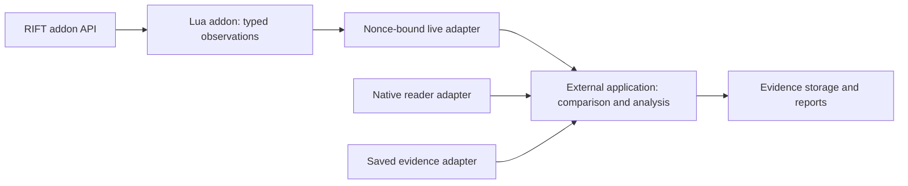

# Architecture

Status: offline foundation, nonce-bound live acquisition, bounded native capture,
and durable field qualification implemented. Runtime validation records identify
the exact executable and restart scope tested for each increment.

Joey authorized an improved, modular, organized, and configurable RiftReader2
foundation. The .NET stack and project boundaries below are implementation
choices made under that authorization; they were not individually prescribed
by Joey. V1 remains evidence and reference material, not an architecture to
copy.

## Shape

RiftReader2 is a hybrid: a Lua addon inside RIFT plus external .NET tooling. The
addon is a first-class product component. The external half has five production
projects and two test projects. CLI handles offline operations; the isolated
Windows-only Live executable composes live acquisition. This preserves strong
boundaries without paying the operating and debugging cost of services, plugin
discovery, a custom scheduler, or a dependency-injection framework before any
of them solve a measured problem.



The minimal Lua addon and offline decoder are implemented and tested together.
The bare RR2A1 producer passed an identified actual-client source gate. RR2L1
decoding, candidate selection, tracking, read-only heap scanning, live
composition, reload clearing, and reader restart/rebinding then passed one
end-to-end RIFT-Lab gate. The final executable later reacquired a restarted RIFT
process and recovered after a graceful VM power cycle with manual relaunch and
new binding. Native-field discovery and qualification remain later
independent V2 work. The addon gathers
supported API data and diagnostics. External tooling handles acquisition,
native research, numerical work, retention, and exports.
The separate finite [native capture path](reference/native-capture.md) retains
explicit raw ranges, process/build identity, timing, hashes, and read failures.
Its Application session port isolates Win32 access in Live. Raw-byte acquisition
does not promote field meanings or replace the addon contract.
The [field catalog](reference/field-catalog.md) adds an offline qualification
workflow. Infrastructure verifies content-pinned artifacts and assessments;
Application evaluates separate meaning, locator, restart, and update claims at
an explicit build/session/time. Reports preserve disagreement and expiration.
Recorded semantic judgments remain distinct from verified file hashes.
See [ADR 0002](decisions/0002-hybrid-addon-and-reader.md) for the hybrid boundary,
freshness and compatibility requirements. [ADR 0003](decisions/0003-addon-observation-contract.md)
and the [wire contract](../contracts/addon/README.md) define the inner boundary;
[ADR 0004](decisions/0004-nonce-bound-addon-transport.md) and the
[RR2L1 contract](../contracts/addon/live-transport-v1.md) define live binding.

| Project | Responsibility | May reference |
|---|---|---|
| `RiftReader2.Domain` | Samples, typed addon observations, analysis meaning, units, options, and result concepts. | .NET base libraries only. |
| `RiftReader2.Application` | Use cases and streaming derived-motion analysis. | Domain. |
| `RiftReader2.Infrastructure` | Strict addon decoding, JSON configuration, capture verification and reading, and atomic result writes. | Domain. |
| `RiftReader2.Cli` | Argument handling, explicit composition, commands, help, and process exit behavior. | Domain, Application, Infrastructure. |
| `RiftReader2.Live` | Windows-only live adapter and composition executable, isolated from portable offline entry points. | Domain, Application, Infrastructure. |
| `RiftReader2.Tests` | Portable behavior and boundary tests. | Core production projects as needed. |
| `RiftReader2.Live.Tests` | Windows scanner, process, and live-I/O tests. | Live and its production dependencies. |

The dependency direction is deliberate:

```text
                  +-------------+  +-------------+
                  |     CLI     |  | Live (Win)  |
                  +------+------+  +------+------+
                         |                |
                +----------------+----------------+
                |                |                |
                v                v                v
       +-------------+   +----------------+   +--------+
       | Application |   | Infrastructure |   | Domain |
       +------+------+   +-------+--------+   +--------+
              |                  |
              +------------------+
                         |
                         v
                    +--------+
                    | Domain |
                    +--------+
```

Domain does not know about files, JSON, command lines, processes, RIFT memory,
or V1. Application does not know which file format or capture adapter supplies
samples. Infrastructure handles external representations without deciding what
observations mean. CLI and Live contain their respective composition and
presentation, not analysis rules. Live's Windows target does not make the core
projects platform-specific.

## First operation

The first implemented path is deterministic offline analysis:

1. CLI loads a versioned configuration.
2. Infrastructure loads a capture manifest, resolves its plain sample filename
   beside the manifest, verifies the declared SHA-256 digest, and then streams
   JSON Lines from the same open file handle.
3. Application validates the ordered sample stream and derives movement deltas,
   horizontal distance and interval-average speed, shortest-path yaw change and
   interval-average yaw rate, and sample-gap diagnostics. Shortest-path yaw
   assumes the body turns less than half a revolution between observations.
4. Infrastructure writes the result as JSON through a same-directory temporary
   file followed by a no-overwrite move.

Raw observations remain distinguishable from derived values and semantic
claims. A successful calculation on a synthetic capture does not qualify a RIFT
field or reproduce a V1 conclusion.

The supported entry points are:

```powershell
dotnet run --project src/RiftReader2.Cli -- analyze --manifest samples/demo/capture.json --config config/default.json --output artifacts/demo-analysis.json
dotnet run --project src/RiftReader2.Cli -- validate-capture --manifest samples/demo/capture.json
dotnet run --project src/RiftReader2.Cli -- --help
```

The demo dataset is synthetic and illustrative. It proves the local pipeline
and its contracts, not RIFT behavior.

## Versioned boundaries

The addon schema is separate from complete motion captures. Four Lua modules
separate fixed-schema encoding, bounded sampling/lifecycle state, one-load live
binding, and game event hookup. The decoder returns typed Domain observations;
offline reports carry
the exact input-frame SHA-256 and always mark binding as `unbound` and freshness
as `unverified`. A local epoch/sequence is not a unique addon-load identity.
No yaw or native provenance is fabricated. Lua 5.1 and C# execute the same
fixtures. Actual-client evidence validates the bare RR2A1 source and RR2L1
runtime paths including reload clearing, reader restart/rebinding, RIFT process
restart, and graceful VM restart with manual relaunch and rebinding.

The live scanner covers only readable, committed `MEM_PRIVATE` regions and
reports complete only after finishing its declared domain within every budget.
Malformed candidates are diagnostic counts, never observations. No strict
matching candidate yields unavailable; valid same-sequence conflicts invalidate.
Freed Lua strings may remain, so unrelated garbage is not itself a conflict.
The target hash identifies the on-disk MainModule path after process identity
rechecks; it does not verify loaded module bytes. A delivery receipt remains
separate from guest-side freshness and never implies game readiness.

Configuration schema version 1 contains an `analysis` object with
`maxGapSeconds` and `maxSamples` JSON properties. Its top-level
`maxCaptureBytes` input limit defaults to 268,435,456 and has an accepted
ceiling of 8 GiB. Configuration parsing is strict: malformed input, unsupported
schema versions, missing, duplicate, or unknown properties, and invalid ranges
fail clearly instead of silently changing behavior.

Capture manifest schema version 1 records:

- `sourceKind`: declared `synthetic` or `rift-recording` origin;
- `buildSha256`: the producer's declared identity for the observed RIFT build,
  where applicable;
- `sessionId`: identity shared by every sample in the capture;
- `positionUnits`: the declared nonblank position unit;
- `coordinateFrame`: declared `xz-horizontal-y-up` axes;
- `clockBasis`: declared `session-monotonic-seconds` timestamp basis;
- `timingUncertaintySeconds`: finite nonnegative uncertainty, or `null` when the
  producer does not know it;
- `samplesFile`: a plain filename located beside the manifest;
- `samplesSha256`: SHA-256 identity of the exact sample bytes.

The reader validates the `buildSha256` representation but cannot prove which
executable produced it. `samplesSha256` binds the exact saved sample bytes; it
does not establish executable provenance or field meaning.

Each UTF-8 JSON Lines sample records `sessionId`, `sequence`,
`timestampSeconds`, `x`, `y`, `z`, and `yawRadians`; a line may be no longer than
16,384 characters. Readers reject missing, duplicate, or unknown JSON members
and incompatible identity, sequence, timestamp, numeric, count, size, and digest
conditions. Version 1 is the only accepted schema version. New meanings require
a new schema version and an explicit compatibility decision.

The repository pins the .NET 10 SDK (`10.0.302`) with SDK roll-forward disabled
and pins test package versions. Product projects use base-library dependencies
only. Package lock files make restore drift visible.

Analysis reports include input provenance, the effective configuration, and the
meaning of derived values. Provenance includes `toolVersion`, SHA-256 identities
for the four product assemblies, `samplesHashVerification: verified`, and
`buildIdentityVerification: declared-only`. The manifest's source, units,
coordinate frame, clock basis, and timing uncertainty remain producer
declarations; the foundation has no live capture result that independently
confirms them. Output is optional. When requested, a new report is written
through a same-directory temporary file and moved into place without
overwriting; an existing destination is an explicit failure.

## Extension policy

Add capability through a bounded adapter or use case while preserving the
dependency direction. Extract an interface when the next real adapter or test
seam requires it; do not create speculative abstractions for imagined variants.
Explicit construction in CLI should remain easy to read while there is one
composition path.

Current and expected additions are:

- further qualification of the live addon adapter across hard crashes, VM
  snapshot restore/resume, and update recovery;
- independently developed V2 native-field discovery and read-only capture with
  process/build identity; no generic offset or native-field readiness is
  currently claimed;
- optional operational reuse of the unchanged V1 receiver/console in the lab,
  without importing V1 application architecture or treating it as V2 evidence;
- independent import or replay of selected V1 evidence;
- real field assessments within the implemented durable catalog, preserving
  locator, applicability, validation, and invalidation evidence;
- guarded experiment support for controlled movement and turning tests;
- optional SQLite indexing only after file-based evidence demonstrates a query,
  scale, or integrity need that JSON artifacts cannot meet cleanly.

Navigation, combat, and player automation remain outside RiftReader2. Additional
external services, dynamically loaded .NET plugins, and extra external processes
need evidence of a concrete requirement before adoption. The in-game Lua addon
is already part of the required architecture.

## Change rules

- Keep Domain free of adapters and external formats.
- Preserve source, build, session, schema, and content identity at evidence
  boundaries.
- Stream captures; do not require loading an entire large capture into memory.
- Write generated captures, logs, caches, and analysis output under
  `artifacts/` unless a small synthetic fixture is intentionally tracked.
- Add the narrowest meaningful test for changed behavior.
- Record material boundary, schema, storage, or process changes in a numbered
  decision record.
- Validate with [the development workflow](workflows/development.md).

The exact version-1 fields and validation rules are documented in
[the capture contract](reference/capture-format.md).

See [ADR 0001](decisions/0001-modular-offline-foundation.md) for the decision
and [the implementation roadmap](planning/implementation-roadmap.md) for the
increment order.

## Implementation references

Reviewed 2026-10-18:

- [Microsoft Learn: global.json overview](https://learn.microsoft.com/en-us/dotnet/core/tools/global-json)
  defines `rollForward: disable` as requiring an exact SDK match.
- [Microsoft Learn: required JSON properties](https://learn.microsoft.com/en-us/dotnet/standard/serialization/system-text-json/required-properties)
  documents required-member deserialization behavior.
- [Microsoft Learn: unmapped JSON members](https://learn.microsoft.com/en-us/dotnet/standard/serialization/system-text-json/missing-members)
  documents rejecting properties absent from the target contract.
